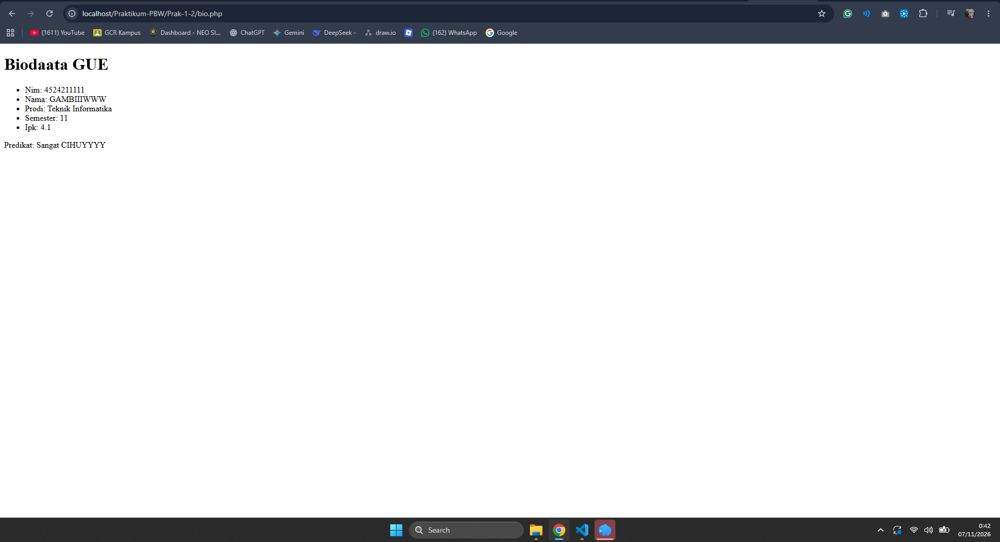
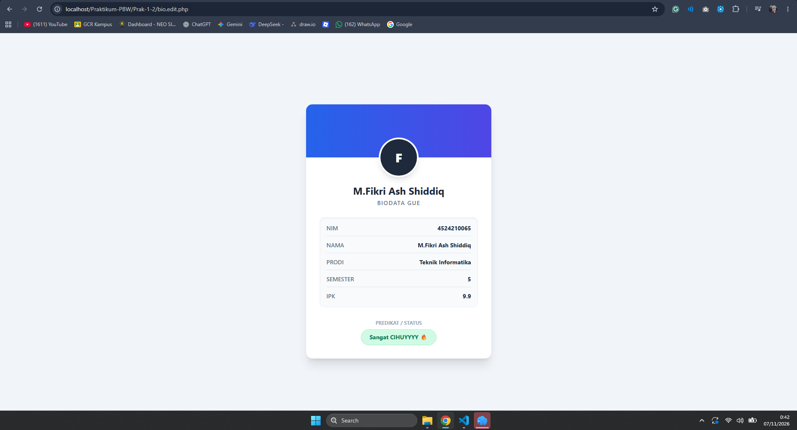
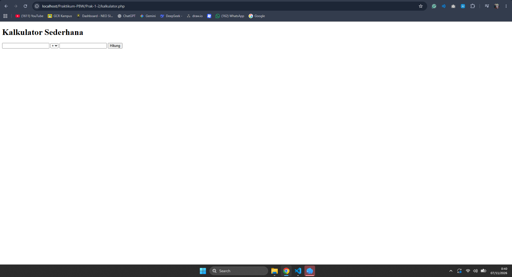
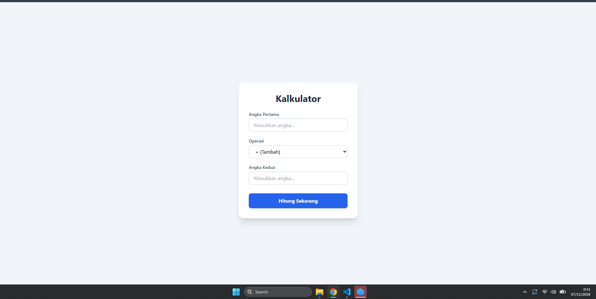
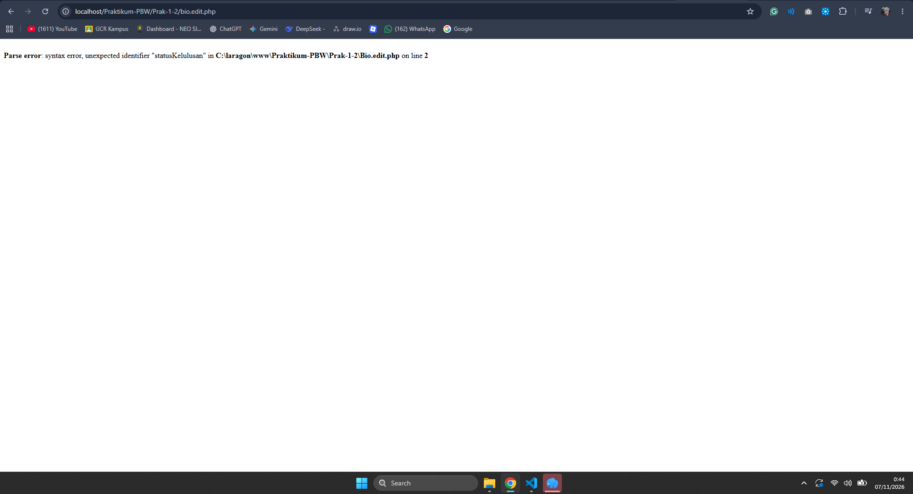

# 📘 Laporan Praktikum Pertemuan 1 dan 2
### Tugas 1 dan Tugas 2

🧑‍🎓 **Muhammad Fikri Ash Shiddiq - 4524210065**

# 💻 Praktikum Pemrograman Web – Dasar PHP

Praktikum ini membahas dasar pemrograman PHP, konsep komunikasi client-server, serta penggunaan HTTP Method GET dan POST. Pada tugas ini dilakukan pengujian dan pengembangan terhadap dua program PHP yang telah diberikan oleh asisten praktikum, yaitu program Biodata Mahasiswa dan Kalkulator Sederhana.

Pengembangan dilakukan dengan memperbaiki beberapa bagian kode serta memperbarui tampilan antarmuka menggunakan Tailwind CSS agar program terlihat lebih menarik, rapi, dan mudah digunakan.

<p align="center">
  
  
  
  
</p>

---

## 📋 Daftar Isi

- [Tentang Praktikum](#-tentang-praktikum)
- [Tujuan Praktikum](#-tujuan-praktikum)
- [Program yang Dikerjakan](#-program-yang-dikerjakan)
- [Hasil Modifikasi](#-hasil-modifikasi)
- [Penjelasan Bagian Kode](#-penjelasan-bagian-kode-penting)
- [Dokumentasi Tampilan](#-dokumentasi-tampilan)
- [Error dan Penyelesaian](#-error-dan-penyelesaian)
- [Teknologi yang Digunakan](#️-teknologi-yang-digunakan)
- [Instalasi dan Menjalankan Program](#-instalasi-dan-menjalankan-program)
- [Kesimpulan](#-kesimpulan)

## 🎯 Tentang Praktikum

Praktikum Pertemuan 1 dan 2 merupakan pengenalan dasar pemrograman web menggunakan PHP. Materi yang dipelajari mencakup bagaimana PHP bekerja di sisi server, bagaimana browser berkomunikasi dengan server, serta bagaimana data dikirim menggunakan metode HTTP GET dan POST.

Dalam pengerjaan tugas, terdapat dua program utama yang digunakan sebagai bahan pembelajaran:

1. **Biodata Mahasiswa** – Program untuk menampilkan informasi mahasiswa menggunakan array, perulangan, dan fungsi PHP.
2. **Kalkulator Sederhana** – Program untuk melakukan operasi aritmatika menggunakan input dari pengguna dan pemrosesan data melalui metode POST.

Kedua program tersebut kemudian dikembangkan dengan memperbaiki bagian kode tertentu dan memberikan pembaruan pada desain tampilannya.

## 📌 Tujuan Praktikum

1. Memahami dasar penulisan sintaks PHP.
2. Mengenal konsep client-server dalam pengembangan website.
3. Memahami penggunaan HTTP Method GET dan POST.
4. Mempraktikkan penggunaan variabel, array, fungsi, kondisi, dan perulangan.
5. Memahami proses pengolahan input dari pengguna menggunakan PHP.
6. Mengembangkan tampilan website menggunakan HTML dan Tailwind CSS.
7. Melatih kemampuan dalam menemukan kesalahan kode serta memperbaikinya.

## 📂 Program yang Dikerjakan

Terdapat dua program utama beserta masing-masing versi hasil pengembangannya.

| Nama File | Keterangan |
|---|---|
| `bio.php` | Program biodata mahasiswa sebelum modifikasi |
| `bio.edit.php` | Program biodata mahasiswa setelah modifikasi |
| `kalkulator.php` | Program kalkulator sebelum modifikasi |
| `kalkulator.edit.php` | Program kalkulator setelah modifikasi |

### 1. Biodata Mahasiswa

Program biodata menggunakan array asosiatif untuk menyimpan informasi mahasiswa, seperti NIM, nama, program studi, semester, dan IPK.

Data tersebut ditampilkan menggunakan perulangan `foreach`. Selain itu, terdapat fungsi `statusKelulusan()` untuk menentukan predikat berdasarkan nilai IPK.

### 2. Kalkulator Sederhana

Program kalkulator digunakan untuk melakukan perhitungan aritmatika berdasarkan dua angka dan operator yang dipilih pengguna.

Pemrosesan dilakukan menggunakan HTTP Method POST, kemudian hasil perhitungan ditampilkan kembali pada halaman yang sama.

Operasi yang tersedia meliputi:
- Penjumlahan (+)
- Pengurangan (-)
- Perkalian (*)
- Pembagian (/)

## ✨ Hasil Modifikasi

Pengembangan dilakukan pada kedua program dengan fokus pada perbaikan kode dan pembaruan tampilan antarmuka.

### 1. Modifikasi Program Biodata

Beberapa perubahan yang dilakukan pada program biodata antara lain:

- **Pembaruan desain antarmuka:** Mengubah tampilan HTML sederhana menjadi kartu profil mahasiswa dengan desain yang lebih modern.
- **Penambahan Tailwind CSS:** Menggunakan Tailwind CSS melalui CDN untuk mengatur warna, ukuran, jarak, dan tata letak.
- **Banner gradasi:** Menambahkan bagian header dengan kombinasi warna biru dan ungu.
- **Avatar inisial:** Menampilkan huruf inisial mahasiswa secara otomatis menggunakan fungsi `strtoupper()` dan `substr()`.
- **Penyusunan data:** Mengubah penyajian informasi menjadi tampilan seperti tabel dengan bantuan elemen HTML dan utility class Tailwind CSS.
- **Penambahan elemen visual:** Memberikan badge khusus untuk menampilkan predikat atau status kelulusan.

Fungsi `statusKelulusan()` dan perulangan `foreach` tetap digunakan sebagai bagian utama pengolahan data PHP.

### 2. Modifikasi Program Kalkulator

Pada program kalkulator, perubahan lebih difokuskan pada tampilan dan kenyamanan penggunaan.

Beberapa pembaruan yang dilakukan:

- Mengubah tampilan standar HTML menjadi layout berbentuk card.
- Menggunakan warna latar belakang abu-abu muda dengan kombinasi warna biru.
- Menambahkan label pada setiap kolom input.
- Menambahkan placeholder sebagai petunjuk pengisian angka.
- Mempertahankan nilai input setelah tombol hitung ditekan.
- Menambahkan efek visual pada tombol menggunakan utility class Tailwind CSS.
- Membuat notifikasi kesalahan dengan tampilan khusus berwarna merah.
- Menampilkan hasil perhitungan menggunakan kotak khusus berwarna hijau.

Logika utama perhitungan tetap menggunakan struktur `switch-case` dan metode POST seperti pada program awal.

## 🧠 Penjelasan Bagian Kode Penting

Berikut beberapa bagian kode yang memiliki peran penting dalam kedua program.

### 1. Fungsi statusKelulusan()

```php
function statusKelulusan(float $ipk): string
{
    if ($ipk >= 3.50) return 'Sangat CIHUYYYY 🔥';
    if ($ipk >= 3.00) return 'Memuaskan 👍';
    return 'Perlu Peningkatan 📈';
}
```

Fungsi ini digunakan untuk menentukan predikat mahasiswa berdasarkan nilai IPK. Parameter `$ipk` menggunakan tipe data `float`, sedangkan hasil yang dikembalikan menggunakan tipe data `string`.

Pengecekan dilakukan menggunakan kondisi `if` untuk menentukan predikat yang sesuai.

### 2. Array Asosiatif Mahasiswa

```php
$mahasiswa = [
    'nim' => '4524210065',
    'nama' => 'M.Fikri Ash Shiddiq',
    'prodi' => 'Teknik Informatika',
    'semester' => 5,
    'ipk' => 9.9
];
```

Array asosiatif digunakan untuk menyimpan data mahasiswa dalam bentuk pasangan key dan value. Setiap informasi memiliki nama kunci masing-masing sehingga data lebih mudah dipanggil dan dikelola.

### 3. Perulangan foreach

```php
<?php foreach ($mahasiswa as $kunci => $nilai): ?>
    <li>
        <?= htmlspecialchars($kunci) ?>
        <?= htmlspecialchars((string)$nilai) ?>
    </li>
<?php endforeach; ?>
```

Perulangan `foreach` digunakan untuk membaca seluruh isi array mahasiswa secara otomatis. Variabel `$kunci` berisi nama atribut, sedangkan `$nilai` berisi data dari atribut tersebut.

Penggunaan perulangan ini membuat kode lebih praktis karena tidak perlu menuliskan setiap informasi mahasiswa secara manual.

### 4. Pengecekan HTTP Method POST

```php
if ($_SERVER['REQUEST_METHOD'] === 'POST') {
    $a = (float) ($_POST['a'] ?? 0);
    $b = (float) ($_POST['b'] ?? 0);
    $operator = $_POST['operator'] ?? '+';
}
```

Bagian ini digunakan untuk memastikan bahwa proses perhitungan hanya dilakukan ketika pengguna mengirimkan formulir menggunakan metode POST.

Nilai dari input kemudian diambil melalui `$_POST` dan dikonversi menjadi tipe data `float` agar dapat digunakan dalam operasi aritmatika.

### 5. Struktur switch-case dan Validasi Pembagian

```php
switch ($operator) {
    case '+':
        $hasil = $a + $b;
        break;

    case '-':
        $hasil = $a - $b;
        break;

    case '*':
        $hasil = $a * $b;
        break;

    case '/':
        if ($b == 0) {
            $pesan = 'Error: Tidak dapat membagi dengan nol!';
        } else {
            $hasil = $a / $b;
        }
        break;
}
```

Struktur `switch-case` digunakan untuk menentukan operasi matematika berdasarkan operator yang dipilih pengguna.

Pada operasi pembagian, terdapat kondisi tambahan untuk memeriksa apakah angka kedua bernilai nol. Hal ini dilakukan agar program tidak menjalankan pembagian dengan nol dan dapat menampilkan pesan kesalahan kepada pengguna.

## 📸 Dokumentasi Tampilan

Berikut merupakan dokumentasi hasil pengujian program sebelum dan sesudah dilakukan pengembangan.

### 1. Program Biodata Mahasiswa

**a. Sebelum Modifikasi**

Tampilan awal biodata masih menggunakan elemen HTML standar tanpa tambahan styling khusus.



**b. Sesudah Modifikasi**

Setelah dikembangkan, biodata memiliki tampilan kartu profil dengan banner gradasi, avatar inisial, daftar informasi mahasiswa, dan badge predikat.



### 2. Program Kalkulator

**a. Sebelum Modifikasi**

Kalkulator awal memiliki tampilan sederhana berupa dua kolom input, pilihan operator, dan tombol hitung.



**b. Sesudah Modifikasi**

Tampilan kalkulator diperbarui menggunakan Tailwind CSS dengan tata letak yang lebih terstruktur, label input, placeholder, serta tombol hitung yang lebih menarik.



## ⚠️ Error dan Penyelesaian

Selama proses pengerjaan modifikasi program biodata, ditemukan kesalahan sintaks yang menyebabkan halaman tidak dapat ditampilkan dengan semestinya.

### 1. Jenis Error

<details>
<summary><b>Parse Error: Syntax Error</b></summary>

```text
Parse error: syntax error, unexpected identifier
"statusKelulusan" on line 2
```

</details>

Error tersebut muncul ketika program dijalankan melalui browser setelah dilakukan pengeditan pada file `bio.edit.php`.

### 2. Penyebab Error

Kesalahan terjadi karena terdapat kesalahan pengetikan pada deklarasi fungsi PHP.

Kode yang menyebabkan error:

```php
functn statusKelulusan(float $ipk): string
```

Kata `function` tidak ditulis secara lengkap sehingga PHP tidak dapat mengenali deklarasi fungsi tersebut.

### 3. Langkah Perbaikan

Kesalahan diperbaiki dengan mengubah penulisan `functn` menjadi `function`.

Kode setelah diperbaiki:

```php
function statusKelulusan(float $ipk): string
{
    if ($ipk >= 3.50) return 'Sangat CIHUYYYY 🔥';
    if ($ipk >= 3.00) return 'Memuaskan 👍';
    return 'Perlu Peningkatan 📈';
}
```

### 4. Hasil Perbaikan

Setelah kesalahan penulisan diperbaiki, program dapat dijalankan kembali dan fungsi `statusKelulusan()` dapat diproses sebagaimana mestinya.

**Dokumentasi error:**



## 🛠️ Teknologi yang Digunakan

| Teknologi | Kegunaan |
|---|---|
| PHP 8.2+ | Mengolah data dan menjalankan logika program di sisi server |
| HTML5 | Menyusun struktur halaman website |
| Tailwind CSS | Mengatur tampilan dan desain antarmuka |
| Laragon | Menjalankan server lokal untuk pengujian |
| Apache | Menangani permintaan HTTP dari browser |
| Visual Studio Code | Editor untuk menulis dan mengembangkan kode |

## 🚀 Instalasi dan Menjalankan Program

### Persyaratan Sistem

Sebelum menjalankan program, pastikan perangkat sudah memiliki:

- Sistem operasi Windows.
- Laragon atau XAMPP.
- PHP versi 8.2 atau lebih baru.
- Browser seperti Google Chrome.
- Visual Studio Code atau editor kode lainnya.

### 1. Menyiapkan Laragon

Download dan install Laragon terlebih dahulu. Setelah proses instalasi selesai, buka aplikasi Laragon kemudian klik **Start All** untuk menjalankan layanan Apache.

### 2. Menempatkan Folder Project

Simpan folder project di dalam direktori web server Laragon:

```text
C:\laragon\www\Praktikum-PBW
```

Pastikan struktur folder program sesuai dengan susunan berikut:

```text
Praktikum-PBW/
│
└── Prak-1-2/
    │
    ├── bio.php
    ├── bio.edit.php
    ├── kalkulator.php
    ├── kalkulator.edit.php
    │
    └── docs/
        └── images/
            ├── bio-sebelum.png
            ├── bio-sesudah.png
            ├── kalkulator-sebelum.png
            ├── kalkulator-sesudah.png
            └── error.png
```

### 3. Menjalankan Program

Setelah Apache aktif, buka browser dan masukkan alamat berikut:

| Program | URL |
|---|---|
| Biodata Awal | `http://localhost/Praktikum-PBW/Prak-1-2/bio.php` |
| Biodata Modifikasi | `http://localhost/Praktikum-PBW/Prak-1-2/bio.edit.php` |
| Kalkulator Awal | `http://localhost/Praktikum-PBW/Prak-1-2/kalkulator.php` |
| Kalkulator Modifikasi | `http://localhost/Praktikum-PBW/Prak-1-2/kalkulator.edit.php` |

### 4. Catatan Tambahan

Program ini menggunakan PHP dan HTML tanpa database, sehingga tidak memerlukan konfigurasi MySQL maupun proses migrasi database.

Tailwind CSS dipanggil melalui CDN, sehingga koneksi internet diperlukan ketika halaman pertama kali dimuat untuk mengambil file CSS dari CDN.

Composer juga tidak diperlukan karena program tidak menggunakan dependency PHP tambahan.

## 📝 Kesimpulan

Berdasarkan praktikum yang telah dilakukan, dapat dipahami bahwa PHP dapat digunakan untuk mengolah data dan membangun halaman web yang interaktif melalui komunikasi antara browser dan server.

Melalui pengembangan program biodata dan kalkulator, diperoleh pengalaman dalam menggunakan array, fungsi, perulangan, percabangan, serta pengolahan data menggunakan metode POST.

Selain memahami logika pemrograman, praktikum ini juga memberikan pengalaman dalam memperbaiki kesalahan sintaks dan mengembangkan tampilan antarmuka menggunakan Tailwind CSS.

Dengan demikian, kedua program tidak hanya berhasil dijalankan, tetapi juga mengalami pengembangan dari sisi tampilan dan penyusunan kode.

---

<p align="center">
  Made with ❤️ by Muhammad Fikri Ash Shiddiq
</p>