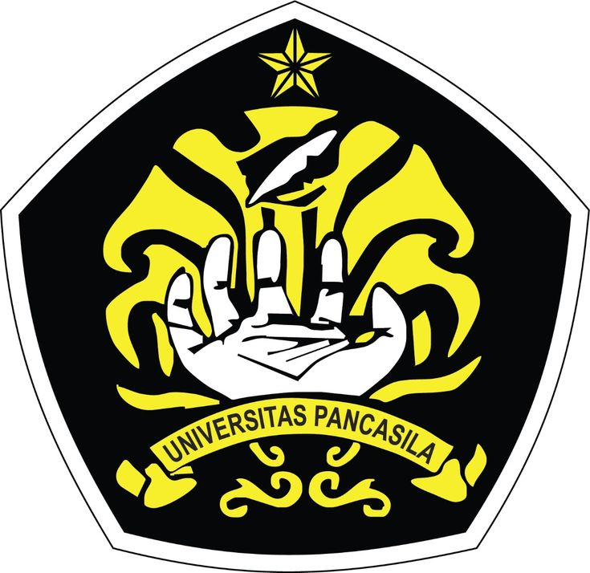
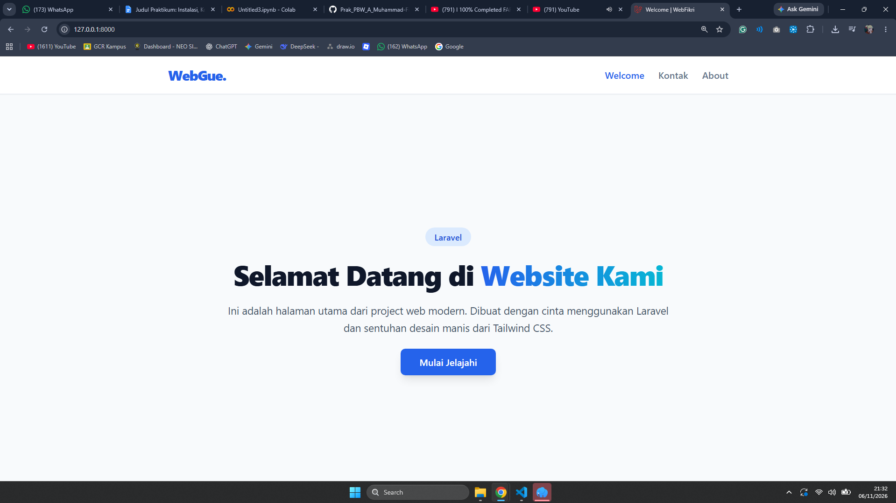
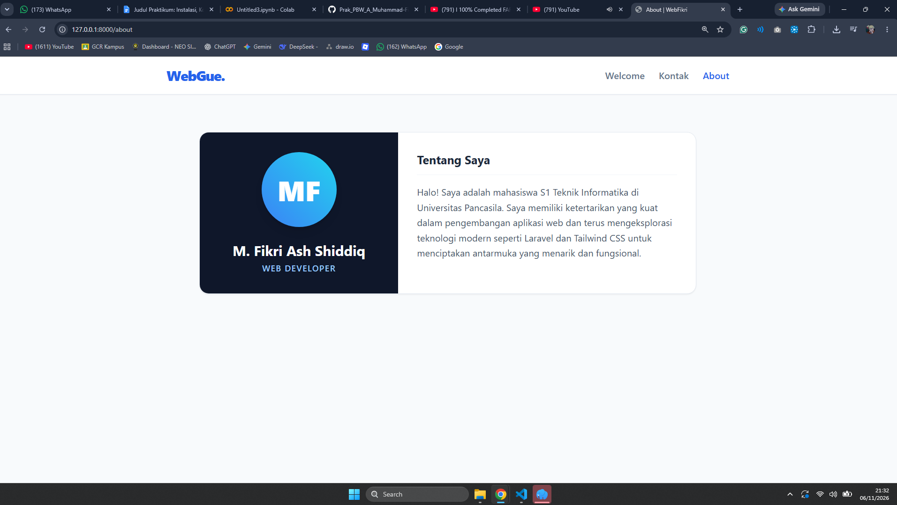
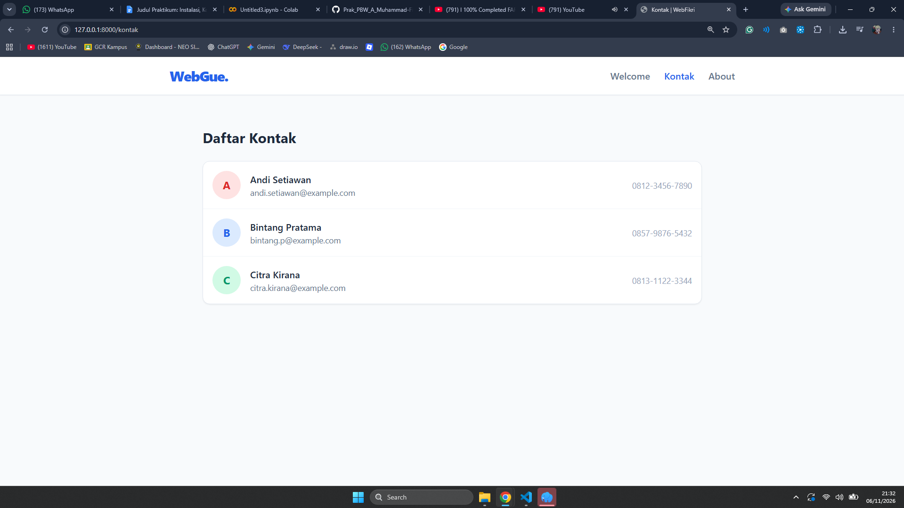

# LAPORAN PRAKTIKUM PEMROGRAMAN BERBASIS WEB

## Modul 3: Instalasi, Konfigurasi, dan Halaman Pertama Laravel



**Disusun Oleh:**
Muhammad Fikri Ash-Shiddiq - 4524210065

**Dosen Pengampu:**
Bambang Riono Arsad, S.Kom., MMSI

**Program Studi Teknik Informatika**
**Universitas Pancasila**
**2026/2027**

---

## 🎯 Tujuan Pembelajaran
1. Menginstal proyek Laravel 12 baru menggunakan Composer.
2. Menjalankan *server development* lokal menggunakan `php artisan serve`.
3. Memahami struktur folder esensial pada framework Laravel.
4. Mendefinisikan rute (*Route*) sederhana di `routes/web.php`.
5. Membuat dan memodifikasi file tampilan (*View*) menggunakan *Blade Templating Engine*.
6. Memahami alur kerja fundamental Laravel: `Request -> Route -> View -> Response`.

---

## 🚀 Langkah Implementasi Praktikum

### 1. Inisialisasi Proyek Laravel
Proyek ini (LaraPress/WebGue) dibangun menggunakan instalasi framework Laravel terbaru (versi 12) dengan perintah:
```bash
composer create-project laravel/laravel: "^12.0" LaraPress
```
Server lokal dijalankan menggunakan perintah bawaan Artisan yaitu `php artisan serve`.

### 2. Pengaturan Routing (`routes/web.php`)
Sesuai dengan alur kerja Laravel, saya mendefinisikan tiga rute utama untuk aplikasi statis ini:
* `/` (Home) -> Mengembalikan view `welcome.blade.php`.
* `/tentang-kami` (About) -> Mengembalikan view `about.blade.php`.
* `/kontak` (Tugas Mandiri) -> Mengembalikan view `kontak.blade.php`.

### 3. Pembuatan Views & Kustomisasi UI (Tailwind CSS)
Sebagai bentuk eksplorasi tambahan di luar HTML dasar yang ada pada modul, saya mengimplementasikan **Tailwind CSS** untuk mempercantik tampilan UI antarmuka. 
* Semua halaman dilengkapi dengan *Navigation Bar* yang interaktif untuk menghubungkan rute Welcome, Kontak, dan About.
* Penggunaan tipografi yang modern dan tata letak (*layout*) yang responsif.

---

## 📝 Penyelesaian Tugas Mandiri

Sesuai dengan instruksi **Bagian 6: Tugas Mandiri (Wajib)** pada modul, saya telah menyelesaikan hal berikut:
1. Membuat halaman statis baru bernama **"Kontak"**.
2. Mendaftarkan rute `/kontak` pada `routes/web.php`.
3. Mengisi halaman tersebut dengan informasi kontak fiktif.
4. Menambahkan *link* navigasi (Navbar) yang saling terhubung di semua halaman (Home, About, dan Kontak).

---

## 📸 Dokumentasi Hasil (Screenshots)

Berikut adalah hasil eksekusi dari proyek yang telah berjalan di *localhost*:

**1. Halaman Utama (Welcome / Home)**
> Menampilkan halaman utama yang dimodifikasi dengan sentuhan desain Tailwind CSS beserta tombol navigasi dan teks hero.



**2. Halaman Tentang Kami (About)**
> Halaman statis yang berisi informasi singkat mengenai proyek ini.



**3. Halaman Kontak (Tugas Mandiri)**
> Halaman hasil tugas mandiri yang memuat informasi kontak fiktif.



---
*Laporan ini dibuat sebagai bentuk penyelesaian Modul 3 Praktikum PBW.*