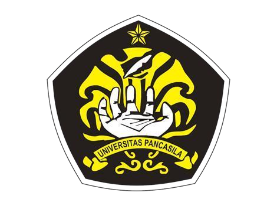

# PRAKTIKUM PEMROGRAMAN BERBASIS WEB

**Disusun Oleh:**  
Muhammad Fikri Ash-Shiddiq — 4524210065

**Dosen Pengampu:**  
Bambang Riono Arsad, S.Kom., MMSI

**Program Studi Teknik Informatika**  
**Universitas Pancasila**  
**Tahun Akademik 2026/2027**

---

## 📌 Tentang Repository

Repository ini merupakan kumpulan hasil pengerjaan tugas dan praktikum mata kuliah **Pemrograman Berbasis Web (PBW)** di Program Studi Teknik Informatika, Universitas Pancasila.

Repository ini dibuat sebagai dokumentasi proses pembelajaran dan implementasi materi yang telah dipelajari selama kegiatan praktikum, mulai dari pemrograman PHP dasar hingga pengembangan aplikasi web menggunakan framework Laravel.

Setiap folder di dalam repository merepresentasikan proyek atau tugas dari pertemuan praktikum yang berbeda. Dokumentasi lengkap mengenai proses pengerjaan, implementasi fitur, kode program, serta hasil pengujian dapat ditemukan pada README di masing-masing folder.

## 🎯 Tujuan Repository

1. Mendokumentasikan seluruh hasil pengerjaan praktikum Pemrograman Berbasis Web.
2. Menerapkan konsep pemrograman web melalui proyek secara langsung.
3. Memahami penggunaan PHP, HTML, CSS, database, dan framework Laravel.
4. Mengembangkan kemampuan dalam membangun aplikasi web yang dinamis dan terstruktur.
5. Menjadi arsip pembelajaran serta referensi untuk pengembangan proyek berikutnya.

## 📂 Daftar Proyek Praktikum

### 1. Praktikum 1–2: Dasar Pemrograman PHP

Mempelajari dasar-dasar pemrograman PHP melalui pembuatan beberapa aplikasi sederhana, seperti halaman biodata mahasiswa dan kalkulator sederhana.

Pada tahap ini juga dilakukan pengembangan tampilan menggunakan HTML, CSS, dan Tailwind CSS untuk memahami integrasi antara logika pemrograman dan antarmuka pengguna.

**Materi utama:**
- Dasar PHP dan sintaks pemrograman.
- Variabel, array, fungsi, dan percabangan.
- Integrasi PHP dengan HTML.
- Pengembangan tampilan menggunakan CSS dan Tailwind CSS.

### 2. Praktikum 3–4: Pengenalan dan Pengembangan Laravel

Mempelajari penggunaan framework Laravel 12 untuk membangun aplikasi web dengan struktur yang lebih terorganisir.

Proyek ini berfokus pada pembuatan halaman website statis, pengaturan routing, penggunaan Blade Templating Engine, serta kustomisasi tampilan menggunakan Tailwind CSS.

**Materi utama:**
- Instalasi dan konfigurasi Laravel.
- Routing dan View.
- Blade Templating Engine.
- Struktur dasar proyek Laravel.
- Navigasi antarhalaman.

### 3. Praktikum 5: SMP Mentari

Mengembangkan aplikasi sistem informasi sederhana untuk SMP Mentari menggunakan Laravel 12.

Aplikasi ini memiliki fitur pengelolaan kegiatan sekolah, buku tamu, dashboard administrator, serta konfigurasi website secara dinamis.

**Fitur utama:**
- Halaman utama informasi sekolah.
- Buku tamu untuk pengunjung.
- Sistem autentikasi menggunakan Laravel Breeze.
- Dashboard administrator.
- CRUD data kegiatan.
- Manajemen pesan buku tamu.
- Pengaturan website secara dinamis.

### 4. Authbook: Aplikasi Manajemen Buku

Mengembangkan aplikasi manajemen buku berbasis Laravel 12 dengan menggunakan Filament 3.x sebagai admin panel.

Proyek ini berfokus pada pengelolaan data buku dan penulis, pengembangan fitur administrasi, serta penerapan sistem pembatasan hak akses pengguna.

**Fitur utama:**
- Manajemen data buku dan penulis.
- CRUD menggunakan Filament Resource.
- Pencarian dan filter data buku.
- Pengelolaan kategori buku.
- Relasi One-to-Many dan Many-to-Many.
- Dashboard statistik dan grafik.
- Role-Based Access Control (RBAC).

## 🛠️ Teknologi dan Tools

Beberapa teknologi dan tools yang digunakan selama pengerjaan praktikum:

| Teknologi | Penggunaan |
|---|---|
| HTML | Struktur halaman web |
| CSS | Pengaturan tampilan |
| PHP | Logika pemrograman backend |
| Tailwind CSS | Pengembangan antarmuka |
| Laravel 12 | Framework aplikasi web |
| Blade | Template halaman Laravel |
| MySQL | Pengelolaan database |
| SQLite | Database aplikasi Authbook |
| Laravel Breeze | Autentikasi pengguna |
| Filament 3.x | Admin panel |
| Livewire | Interaksi antarmuka dinamis |
| Composer | Manajemen dependensi |
| Git & GitHub | Version control dan penyimpanan proyek |

## 📚 Hasil Pembelajaran

Melalui keseluruhan rangkaian praktikum ini, saya memperoleh pengalaman dalam memahami dan menerapkan konsep pengembangan aplikasi berbasis web.

Pembelajaran dimulai dari pembuatan halaman sederhana menggunakan PHP, kemudian berkembang menjadi penggunaan framework Laravel untuk membangun aplikasi yang memiliki pengelolaan database, autentikasi, operasi CRUD, dan pembatasan hak akses pengguna.

Selain memahami teknologi yang digunakan, praktikum ini juga memberikan pengalaman dalam menyelesaikan permasalahan teknis (*debugging*), mengembangkan antarmuka pengguna, serta mengelola proyek menggunakan Git dan GitHub.

## 📝 Penutup

Repository ini diharapkan dapat menjadi dokumentasi perjalanan pembelajaran saya selama mengikuti praktikum Pemrograman Berbasis Web.

Seluruh proyek di dalamnya merupakan hasil implementasi materi praktikum yang dikembangkan secara bertahap sebagai bentuk penerapan pengetahuan dan peningkatan kemampuan dalam bidang pengembangan web.

---

**Muhammad Fikri Ash-Shiddiq**  
**4524210065**  
Teknik Informatika — Universitas Pancasila