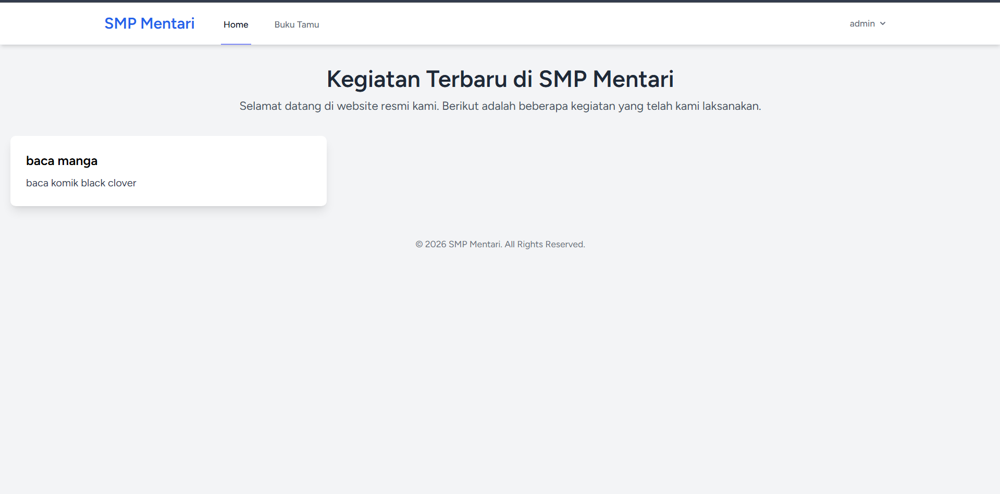
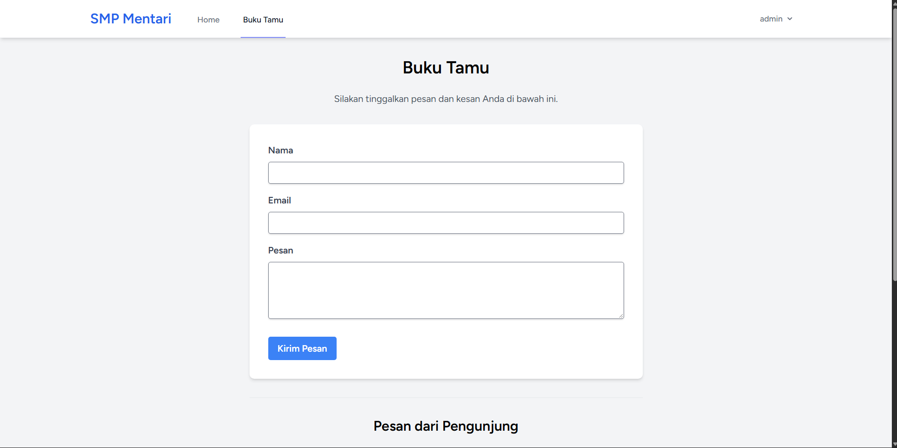
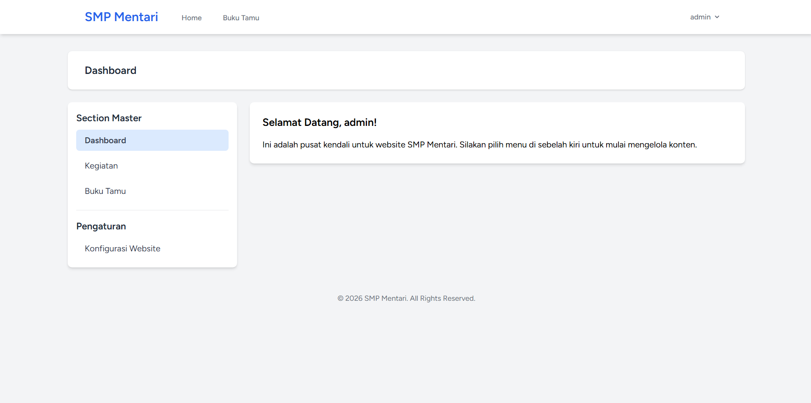
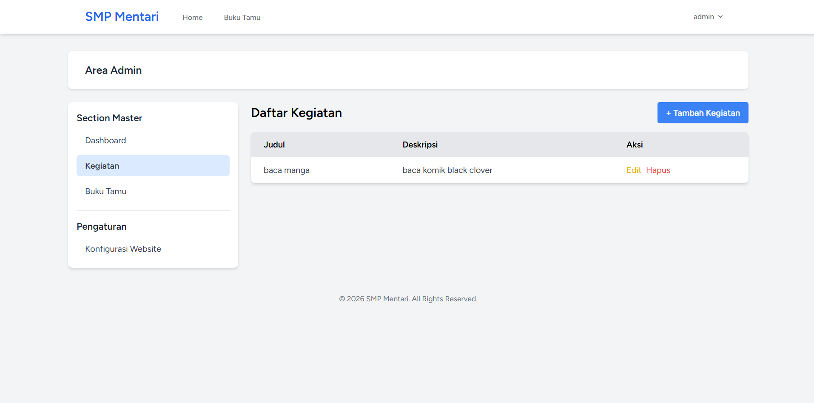
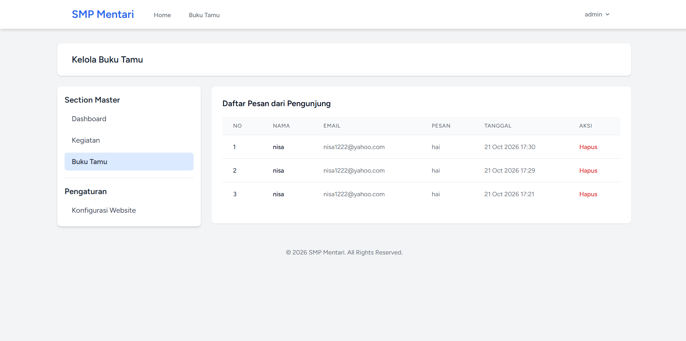
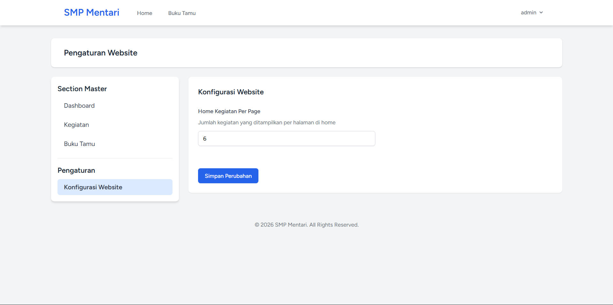

# Modul Praktikum PBW Pertemuan 5 - SMP Mentari

**Mata Kuliah:** Pemrograman Berbasis Web
**Pertemuan:** 5 — Implementasi CRUD, Dynamic Settings, dan Autentikasi
**Tech Stack:** PHP 8.2+, Laravel 12, Laravel Breeze, Tailwind CSS v4, MySQL / SQLite


<br>

**Disusun Oleh:**
Muhammad Fikri Ash-Shiddiq - 4524210065

**Dosen Pengampu:**
Bambang Riono Arsad, S.Kom., MMSI

**Program Studi Teknik Informatika**
**Universitas Pancasila**
**2026/2027**
---

## 1. Persiapan Environment & Inisialisasi Project

Langkah pertama adalah membuat *project* Laravel baru dan menginstal Laravel Breeze untuk sistem autentikasi.

1.  **Buat Project Laravel:**
    ```bash
    composer create-project laravel/laravel SMP-Mentari
    ```
2.  **Install Laravel Breeze (Blade stack):**
    ```bash
    composer require laravel/breeze --dev
    php artisan breeze:install blade
    ```
3.  **Install Frontend Dependencies & Migrate:**
    ```bash
    npm install
    php artisan migrate
    ```

---

## 2. Skema Database & Migrasi

Terdapat tiga tabel utama yang ditambahkan dalam modul ini:

### A. Tabel Pesan Tamu (`pesan_tamus`)
Menyimpan pesan dari pengunjung di halaman Buku Tamu.
*   **Kolom:** `id`, `nama`, `email`, `pesan`, `timestamps`.

### B. Tabel Kegiatan (`kegiatans`)
Menyimpan daftar kegiatan SMP Mentari.
*   **Kolom:** `id`, `judul`, `deskripsi`, `timestamps`.

### C. Tabel Settings (`settings`)
Menyimpan konfigurasi dinamis website (seperti jumlah kegiatan per halaman).
*   **Kolom:** `id`, `key` (unique), `value`, `type`, `description`, `timestamps`.
*   Tabel ini langsung diisi nilai *default* `home_kegiatan_per_page = 6` saat migrasi dijalankan.

---

## 3. Eloquent Model

*   **PesanTamu:** Mengelola data buku tamu (Fillable: `nama`, `email`, `pesan`).
*   **Kegiatan:** Mengelola data kegiatan (Fillable: `judul`, `deskripsi`).
*   **Setting:** Dilengkapi *method* statis `get()`, `set()`, dan `clearCache()` untuk memanajemen konfigurasi yang di-*cache* agar performa lebih cepat.

---

## 4. Controller

Sistem ini memiliki beberapa *controller* untuk mengatur alur data:

*   **PageController:** Mengatur tampilan halaman utama publik (`/home`).
*   **KegiatanController:** Mengatur operasi CRUD (Create, Read, Update, Delete) untuk Kegiatan di area Admin.
*   **PesanTamuController:** Mengatur penyimpanan pesan dari halaman publik dan pengelolaan pesan oleh Admin.
*   **DashboardController:** Mengatur ringkasan statistik (jumlah kegiatan, jumlah pesan) di halaman *dashboard* utama Admin.
*   **SettingController:** Mengatur pembaruan nilai konfigurasi dinamis website di area Admin.

---

## 5. Routing

Rute terbagi menjadi dua bagian:
1.  **Rute Publik:** Bisa diakses siapa saja (`/` untuk Home, `/bukutamu` untuk Buku Tamu).
2.  **Rute Terproteksi (Admin):** Membutuhkan autentikasi (*login*). Rute ini dikelompokkan dengan *middleware* `auth` untuk rute CRUD Kegiatan, kelola Buku Tamu, Pengaturan Website, dan profil pengguna.

---

## 6. Tampilan (Views)

Aplikasi ini menggunakan Blade templating dengan integrasi Tailwind CSS.

### Struktur View:
*   **Layout Utama Publik (`layouts/app.blade.php`):** *Template* dasar dengan integrasi `navigation` cerdas yang menampilkan opsi *Login* jika belum masuk, atau nama *user* jika sudah masuk.
*   **Layout Admin (`layouts/admin.blade.php`):** Mewarisi layout utama dan menambahkan area *sidebar* khusus untuk navigasi modul admin (Dashboard, Kegiatan, Buku Tamu, Konfigurasi Website).

### Halaman Utama:
*   **Home:** Menampilkan *list* kegiatan terbaru dengan dukungan *pagination*.
*   **Buku Tamu Publik:** Formulir bagi pengunjung untuk mengirimkan pesan, serta daftar pesan yang sudah dikirim (berbasis waktu).

### Halaman Admin:
*   **Dashboard:** Ringkasan informasi.
*   **Manajemen Kegiatan (CRUD):** *List* kegiatan berbentuk tabel dengan tombol Tambah, Edit, dan Hapus. Form input sudah dilengkapi dengan validasi.
*   **Manajemen Buku Tamu:** Tabel yang menampilkan seluruh pesan dari pengunjung. Admin dapat membaca dan menghapus pesan.
*   **Konfigurasi Website:** Formulir dinamis untuk mengubah *settings* (misalnya jumlah *item* per halaman).

---

## 7. Eksekusi & Hasil

Untuk menjalankan project:
```bash
composer dev
```
**1. Halaman Utama**


**2. Halaman Buku Tamu**


**3. Dashboard**


**4. Kegiatan**


**4. Catatan Buku Tamu**


**4. Konfigurasi Website**
