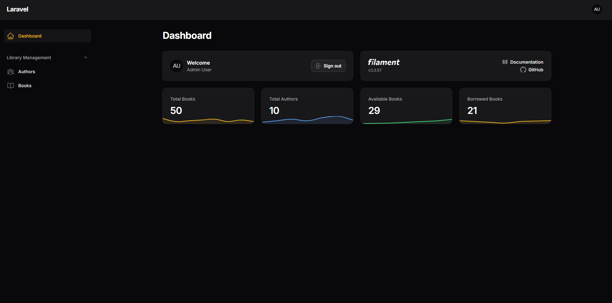
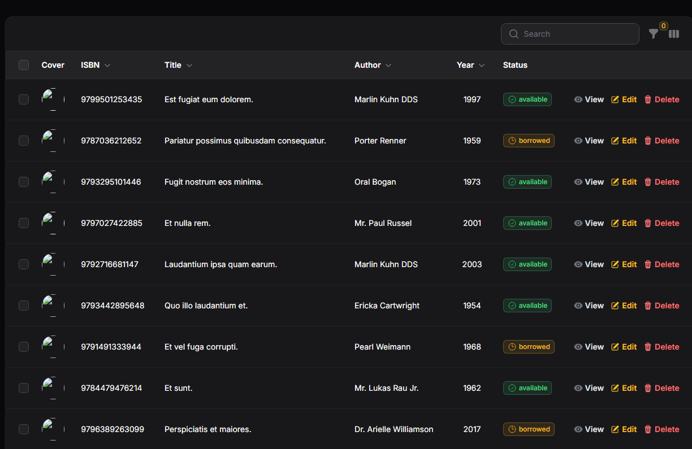
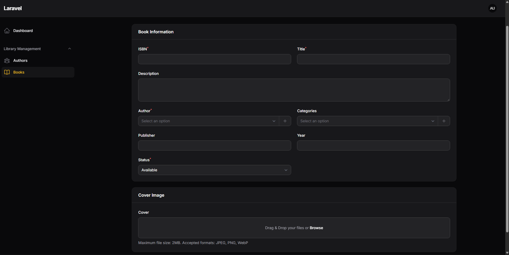
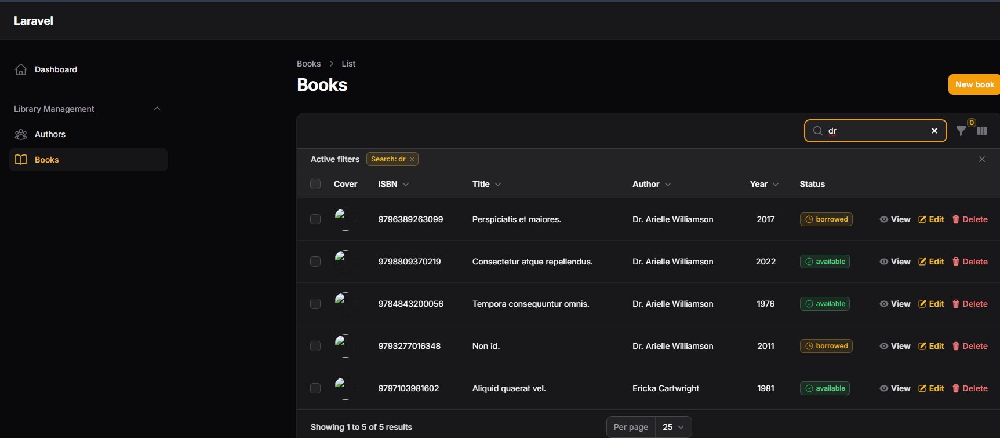
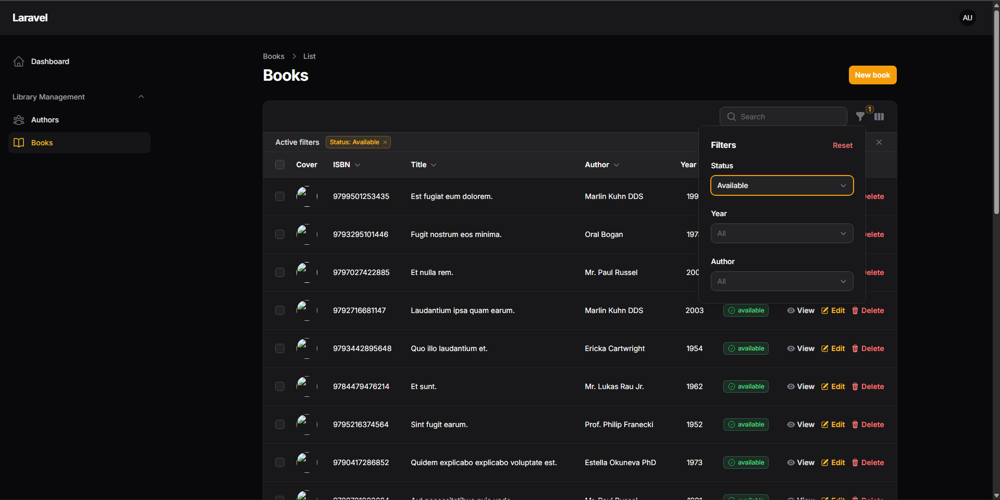
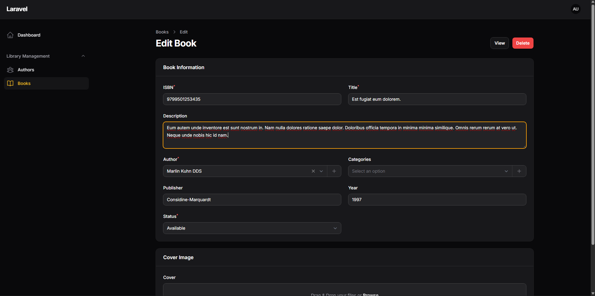
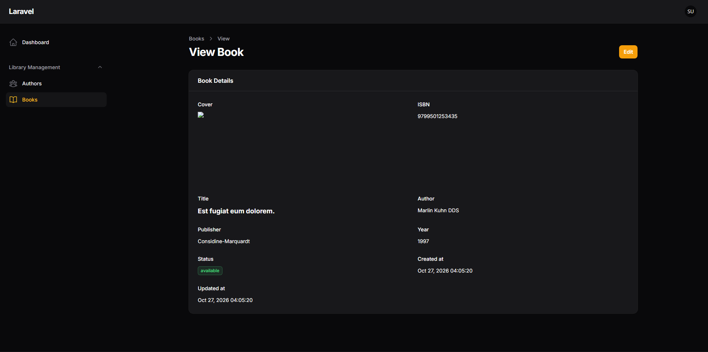
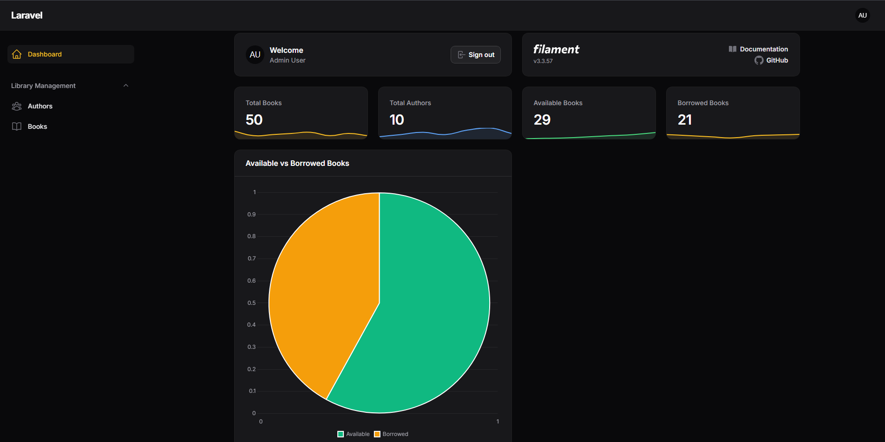
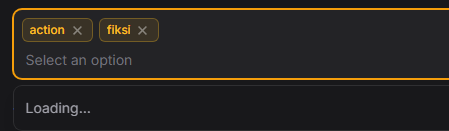
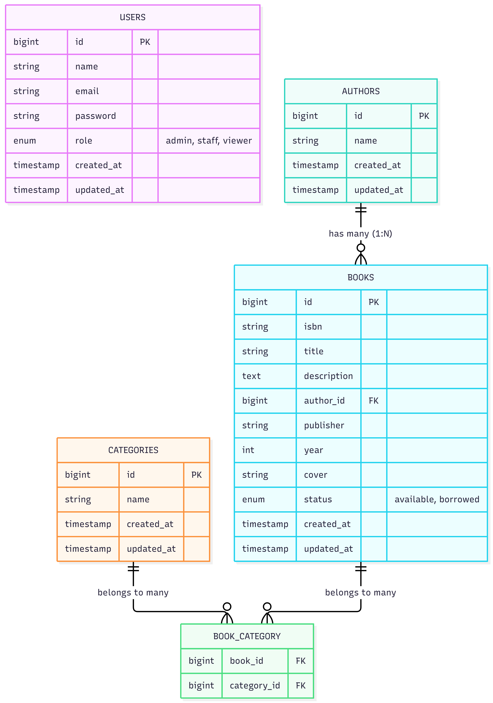

# LAPORAN PRAKTIKUM PEMROGRAMAN BERBASIS WEB
## Modul: Aplikasi Manajemen Buku (Laravel & Filament 3.x) - Authbook

 

**Disusun Oleh:**
Muhammad Fikri Ash-Shiddiq - 4524210065

**Dosen Pengampu:**
Bambang Riono Arsad, S.Kom., MMSI

**Program Studi Teknik Informatika**
**Universitas Pancasila**
**2026/2027**

---

## 📑 Daftar Isi
- [Tugas 1: Implementasi Dasar](#tugas-1-implementasi-dasar)
- [Tugas 2: Kustomisasi dan Pengembangan](#tugas-2-kustomisasi-dan-pengembangan)
- [Tugas 3: Analisis dan Dokumentasi](#tugas-3-analisis-dan-dokumentasi)

---

## 🚀 Tugas 1: Implementasi Dasar

Pada bagian ini, saya melakukan inisiasi *project* Laravel baru, mengonfigurasi database SQLite, dan menginstal *framework* admin panel Filament 3.x. Saya juga telah membuat Model, Migration, Factory, Seeder, dan Resource untuk entitas `Author` dan `Book` beserta relasi *One-to-Many*.

Berikut adalah bukti implementasi dasar fungsionalitas CRUD:

**1. Halaman Utama Admin Panel**

> *Keterangan: Tampilan awal saat berhasil login ke dalam sistem admin panel Filament.*

**2. Halaman Daftar Buku (List Books)**

> *Keterangan: Tabel `BookResource` yang menampilkan 50 data buku hasil dari eksekusi database seeder.*

**3. Form Tambah Buku (Create Book)**

> *Keterangan: Halaman form pembuatan buku baru, lengkap dengan input text, select relasi, dan upload cover.*

**4. Uji Coba Fitur Pencarian (Search)**

> *Keterangan: Hasil tabel ketika mengetikkan kata kunci tertentu pada kolom pencarian.*

**5. Uji Coba Fitur Filter**

> *Keterangan: Tabel daftar buku ketika filter status (contoh: Available) dan tahun diterapkan.*

---

## 🛠️ Tugas 2: Kustomisasi dan Pengembangan

Pada tahap ini, aplikasi dikembangkan lebih lanjut dengan menambahkan beberapa fitur esensial yang membuat manajemen data menjadi lebih kompleks dan aman.

**1. Penambahan Field Deskripsi Buku**

> *Keterangan: Menambahkan tipe data Textarea pada database dan UI form Filament untuk menyimpan sinopsis atau deskripsi buku.*

**2. Implementasi Role-Based Access Control (RBAC)**

> *Keterangan: Penerapan Laravel Policies. Saat login sebagai Staff, tombol/aksi "Delete" tidak ditampilkan karena hak akses dibatasi.*

**3. Widget Dashboard (Stats & Chart)**

> *Keterangan: Menambahkan Widget Statistik (Total Books, Authors) dan Pie Chart untuk membandingkan jumlah buku Available vs Borrowed.*

**4. Kategori Buku (Relasi Many-to-Many)**

> *Keterangan: Relasi tabel pivot `book_category` yang memungkinkan pengguna memilih lebih dari satu kategori di form pengisian data buku.*

---

## 📊 Tugas 3: Analisis dan Dokumentasi

### 1. Penjelasan Arsitektur

#### A. Diagram ERD (Entity Relationship Diagram)

> *Keterangan: Struktur relasi database aplikasi manajemen buku.*

#### B. Penjelasan Relasi Antar Tabel
* **One-to-Many (Author ke Book):** Satu penulis (*Author*) dapat memiliki banyak buku (*Books*), namun satu buku hanya ditulis oleh satu penulis utama. Dihubungkan melalui *foreign key* `author_id` pada tabel `books`.
* **Many-to-Many (Book ke Category):** Satu buku dapat memiliki banyak kategori, dan satu kategori menampung banyak buku. Relasi ini dijembatani oleh tabel pivot `book_category`.
* **Users (Independen):** Tabel ini berdiri secara independen tanpa relasi langsung ke entitas buku dalam ruang lingkup aplikasi saat ini. Fungsinya difokuskan untuk sistem autentikasi dan *Role-Based Access Control* (Admin, Staff, Viewer).

#### C. Penjelasan Flow Aplikasi (Request hingga Response)
1. **Request:** Pengguna (Admin) mengakses URL spesifik, misalnya `/admin/books`.
2. **Routing & Middleware:** Laravel memproses *request* tersebut melalui *routing* internal Filament. *Middleware* memvalidasi status *login* dan *Policy* untuk membatasi aksi berdasarkan *role*.
3. **Controller / Livewire:** Komponen Livewire milik Filament menerima permintaan data.
4. **Model & Database:** Model memanggil Eloquent ORM untuk mengeksekusi *query* ke database SQLite, lalu memuat data dan relasinya.
5. **View & Response:** Data di-render ke dalam UI berbasis Tailwind CSS lalu dikembalikan ke *browser* pengguna sebagai antarmuka HTML interaktif.

### 2. Perbandingan dengan Pendekatan Tradisional

#### A. Bandingkan Membuat CRUD: Filament vs Manual
Pada CRUD tradisional, pembuatan *Route*, *Controller*, View (Blade), validasi, hingga proses upload file dilakukan secara terpisah dari awal. Sebaliknya, Filament menerapkan arsitektur *declarative* di mana developer cukup mendefinisikan skema data pada kelas `Resource`. Filament kemudian menerjemahkannya dan melakukan *generate* UI fungsional, pencarian, dan filter dalam hitungan menit.

#### B. Kelebihan dan Kekurangan
* **Kelebihan Filament:** Sangat cepat untuk *Rapid Application Development* (RAD), UI/UX modern secara *out-of-the-box*, dan memiliki fitur ekosistem yang terintegrasi (Widget, Relasi, Form).
* **Kekurangan Filament:** Memiliki kurva belajar (*learning curve*) tinggi untuk melakukan kustomisasi di luar konvensi standar, dan dirasa berlebihan (*overkill*) untuk proyek yang terlalu sederhana.

#### C. Kapan Menggunakan Filament?
* **Gunakan untuk:** *Admin Panel*, *Backoffice*, *Dashboard* internal perusahaan, atau aplikasi CRUD yang menitikberatkan pada pengolahan data masif secara cepat.
* **Jangan gunakan untuk:** *Landing Page* publik, tampilan antarmuka *e-commerce*, atau aplikasi dengan kebutuhan desain UI kustom yang sangat unik.

### 3. Refleksi Pembelajaran

#### A. Apa yang Dipelajari?
Saya mempelajari arsitektur pengembangan web modern menggunakan Laravel 12 dan Filament 3.x. Saya lebih memahami implementasi RAD, penyusunan database relasional tingkat lanjut (*Pivot Table*), *caching* konfigurasi, hingga penerapan pembatasan hak akses berbasis keamanan (RBAC) melalui fitur Laravel *Policies*.

#### B. Kesulitan yang Dihadapi
1. **Konfigurasi Cache Database:** Mengalami kesulitan saat sistem terus mengarah ke database MySQL padahal konfigurasi diubah ke SQLite. Ini diatasi dengan membersihkan memori sistem via `php artisan optimize:clear`.
2. **Error Rendering Filament:** Mengalami bentrok antarmuka akibat kesalahan menempatkan blok form Kategori ke dalam fungsi khusus Filter Tabel. Saya memperbaikinya dengan merujuk ulang ke dokumentasi struktur kelas `Resource` di Filament.

#### C. Rencana Pengembangan Selanjutnya
Ke depan, aplikasi ini dapat dikembangkan menjadi sistem sirkulasi terpadu dengan menambahkan **Modul Peminjaman (Borrowing Log)**. Fitur ini akan mencatat identitas peminjam, tanggal tenggat (*due date*), petugas yang melayani, hingga perhitungan nominal denda jika terdapat keterlambatan, sehingga fungsinya berkembang menjadi Sistem Informasi Perpustakaan lengkap.